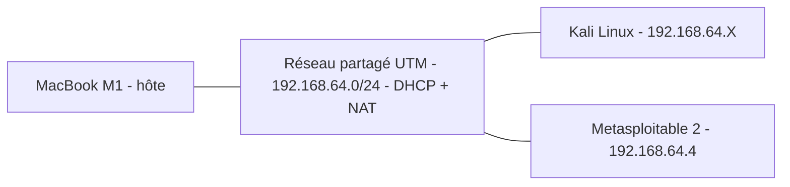

# Homelab - Laboratoire de pentest sur MacBook Pro M1

Laboratoire isolé pour m'entraîner aux tests d'intrusion et à la défense, avec une machine d'attaque et une cible volontairement vulnérable.

## Matériel et logiciels
| Élément | Détail |
| --- | --- |
| Hôte | MacBook Pro M1 Pro (Apple Silicon, ARM) |
| Hyperviseur | UTM (QEMU) |
| Attaquant | Kali Linux 2026.3 ARM64 (virtualisée, 4 Go RAM, 4 CPU) |
| Cible | Metasploitable 2 (Ubuntu 8.04 32 bits, émulée en x86, 1 Go RAM) |

## Architecture réseau

## Choix de sécurité
- **Mode « Réseau partagé » (NAT) uniquement, jamais « Bridged »** : Metasploitable est remplie de failles volontaires. En mode Bridged, elle serait visible par tous les appareils du réseau de la maison. En NAT, elle reste isolée derrière le Mac.
- Les deux machines sont dans le même sous-réseau /24 (254 hôtes possibles) et communiquent directement.

## Problèmes rencontrés et solutions
| Problème | Cause | Solution |
| --- | --- | --- |
| Écran noir « Display output is not active » à l'installation de Kali | L'installateur ARM n'affiche rien sur la carte graphique par défaut | Carte `virtio-gpu-pci` + ajout d'un **terminal série** |
| Kali redémarre sur l'installateur | ISO toujours branchée | Retrait de l'ISO dans les lecteurs |
| Metasploitable sans adresse IP (`ifconfig` : seulement `lo`) | Carte réseau émulée `ne2k_isa` non détectée par ce vieux Linux | Passage à la carte **Intel e1000** |
| Disque Metasploitable au format VMware | UTM utilise le format qcow2 | Conversion avec `qemu-img convert -f vmdk -O qcow2` |

## Vérifications
- `ping -c 4 192.168.64.4` depuis Kali : 4/4 réponses, **TTL 64** (cible Linux, aucun routeur entre les deux).

## Premier scan : `nmap 192.168.64.4`
23 ports TCP ouverts, dont :

| Port | Service | Risque |
| --- | --- | --- |
| 21 | FTP | Identifiants en clair |
| 23 | Telnet | Tout passe en clair (remplacé par SSH) |
| 139 / 445 | SMB | Cible privilégiée des rançongiciels (WannaCry) |
| 512-514 | rexec / rlogin / rsh | Accès à distance sans vraie authentification |
| 1524 | ingreslock | Backdoor (accès root) |
| 3306 / 5432 | MySQL / PostgreSQL | Bases de données exposées sur le réseau |
| 5900 / 6000 | VNC / X11 | Contrôle d'écran à distance |

**Conclusion défensive** : chaque port ouvert agrandit la surface d'attaque. Il faut fermer les services inutiles et remplacer les protocoles en clair (Telnet → SSH, FTP → SFTP).

## Prochaines étapes
- [ ] Rapport de test d'intrusion complet de Metasploitable (énumération, exploitation, recommandations)
- [ ] Ajout d'un serveur Ubuntu avec SIEM Wazuh pour détecter les attaques
